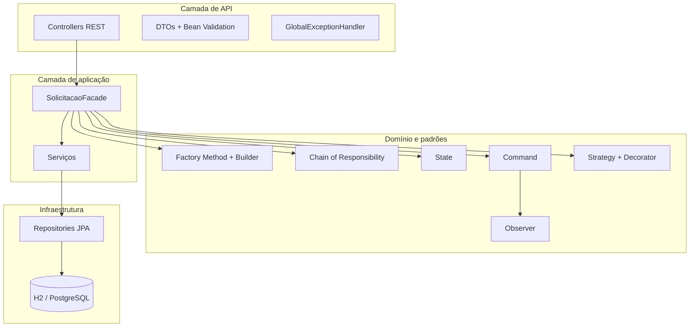

# FlowPatterns — Plataforma Inteligente de Gerenciamento de Solicitações e Aprovações

[](https://adoptium.net/)
[](https://spring.io/projects/spring-boot)
[](https://maven.apache.org/)
[](LICENSE)
[](https://github.com/rafaelkamp/flowpatterns/actions/workflows/ci.yml)

---

## 1. Descrição e objetivo

**FlowPatterns** é uma API REST que gerencia o ciclo completo de solicitações
internas (despesas, compras, férias e acessos) e seu fluxo de aprovação em
até duas etapas (gestor → diretor).

O projeto é o trabalho final do curso **Java | Design Patterns**: cada decisão de
arquitetura foi tomada para resolver um problema real do domínio, e cada padrão GoF
aplicado tem justificativa técnica documentada. Não há padrões "decorativos": todos
possuem código de produção exercitado por testes automatizados.

**Objetivo:** demonstrar, em uma aplicação funcional e pronta para produção, como os
padrões de projeto GoF combinam com as abstrações do Spring Framework para construir
software desacoplado, testável e fácil de evoluir.

## 2. Problema resolvido

Processos de aprovação em empresas costumam sofrer com:

- **Regras espalhadas**: cada tela ou planilha valida um pedaço da regra;
- **Aprovação sem rastro**: não há histórico confiável de quem decidiu o quê e quando;
- **Alertas manuais**: o aprovador precisa "caçar" as solicitações que lhe pertencem;
- **Fila invisível**: não há visão consolidada de volume, atrasos e tempo de aprovação;
- **Processamento repetitivo**: decidir várias solicitações uma a uma consome tempo.

O FlowPatterns centraliza essas regras: cada envio passa por uma cadeia de
validação, o roteamento de alçada é calculado por estratégias configuráveis, cada
decisão é registrada em histórico e notificada aos envolvidos, e um painel consolida
os indicadores do fluxo.

## 3. Funcionalidades

| Recurso | Detalhamento |
|---|---|
| Cadastro de usuários | Nome, e-mail (único), departamento e papel (`SOLICITANTE`, `GESTOR`, `DIRETOR`, `ADMINISTRADOR`) |
| Solicitações | Quatro tipos com campos próprios, estados de rascunho e ciclo de aprovação |
| Validação | Bean Validation na entrada + regras de domínio por tipo + validação condicional no envio |
| Cadeia de aprovação | Alçada por valor/dias/nível de acesso, com aprovação em até duas etapas |
| Decisões | Aprovar, rejeitar e cancelar — unitárias ou **em lote** (com resultado por item) |
| SLA | Prazo em dias úteis por tipo, ajustado por prioridade, com feriados nacionais |
| Histórico | Auditoria completa de criação, envio, aprovação, rejeição e cancelamento |
| Notificações | Caixa de entrada interna gerada por eventos de domínio |
| Consulta | Listagem com filtros, ordenação, paginação e busca textual |
| Painel | Totais por status/tipo, em andamento, atrasadas, tempo médio de aprovação e últimas solicitações |
| Documentação | OpenAPI/Swagger com exemplos de requisição e resposta |
| Erros | Respostas padronizadas em Problem Details (RFC 9457) |

## 4. Tecnologias utilizadas

| Tecnologia | Versão | Uso |
|---|---|---|
| Java | 17 (LTS) | Linguagem base |
| Spring Boot | 3.3.5 | Framework da aplicação |
| Spring Web | 6.1.x | Camada REST |
| Spring Data JPA | 3.3.x | Persistência e Specifications |
| Spring Validation | 8.0.x | Bean Validation |
| Spring Actuator | 3.3.x | Health check |
| Springdoc OpenAPI | 2.6.0 | Swagger UI e OpenAPI JSON |
| H2 | 2.2.x | Banco em memória para desenvolvimento e testes |
| PostgreSQL | 16 | Banco de produção (via profile `postgres`) |
| JUnit Jupiter | 5.10.x | Testes unitários e de integração |
| Mockito | 5.11.x | Isolamento de dependências nos testes |
| Spring Boot Test | 3.3.x | MockMvc, contexto de aplicação |
| AssertJ | 3.25.x | Assertions legíveis |
| Maven | 3.8+ (via Wrapper) | Build e dependências |

## 5. Design Patterns aplicados

| Padrão | Categoria | Onde está | Por que foi escolhido |
|---|---|---|---|
| **Factory Method** | Criacional | `domain/solicitacao/factory` | Cada tipo de solicitação tem campos e regras próprios; o creator abstrato elimina o `switch` de criação |
| **Builder** | Criacional | `domain/solicitacao` | 13 campos comuns + campos específicos tornam construtores telescópicos inviáveis |
| **Singleton** | Criacional | Beans Spring (`@Service`, `@Component`, `@Repository`) | Serviços e estratégias compartilhados, sem recriação por requisição |
| **Strategy** | Comportamental | `domain/solicitacao/strategy` | Prazo de SLA e alçada variam por tipo/regra e precisam ser configuráveis |
| **Chain of Responsibility** | Comportamental | `domain/solicitacao/chain` | O envio exige várias validações sequenciais, extensíveis e independentes |
| **State** | Comportamental | `domain/solicitacao/state` | Transições do ciclo de vida com regras de guarda por status |
| **Command** | Comportamental | `domain/solicitacao/command` | Aprovar/rejeitar/cancelar são ações auditáveis, executáveis em lote |
| **Observer** | Comportamental | `domain/event` + `service/NotificacaoObserver` | Notificações desacopladas do fluxo de aprovação |
| **Facade** | Estrutural | `service/SolicitacaoFacade` | Controllers conhecem uma única porta de entrada do fluxo |
| **Decorator** | Estrutural | `domain/solicitacao/strategy/CalculadoraSlaComPrioridade` | Ajuste por prioridade aplicado a qualquer cálculo de SLA sem alterá-lo |
| **Proxy / Repository** | Estrutural (framework) | Spring Data JPA | Persistência trocável e *lazy loading* sem SQL no código de negócio |

A explicação completa, com diagramas Mermaid, está em
[`docs/DESIGN_PATTERNS.md`](docs/DESIGN_PATTERNS.md).

## 6. Pré-requisitos

- **Java 17+** (JDK) — o build usa `--release 17`;
- **Maven 3.8+** — o projeto já inclui o *Maven Wrapper* (`mvnw`/`mvnw.cmd`), portanto
  não é necessário instalar o Maven;
- **Docker (opcional)** — apenas para subir o PostgreSQL via `docker-compose.yml`;
- **Git (opcional)** — para versionamento do projeto.

## 7. Instalação

```bash
# clonar
git clone https://github.com/rafaelkamp/flowpatterns.git
cd flowpatterns

# baixar dependências e compilar
./mvnw clean install          # Windows: .\mvnw.cmd clean install
```

O Wrapper utiliza Maven 3.8.2 e resolve automaticamente todas as dependências do
Maven Central.

## 8. Configuração do banco de dados

### 8.1 Desenvolvimento e testes (H2 em memória — padrão)

Nenhuma configuração é necessária. O perfil padrão sobe o H2 em memória:

```yaml
spring:
  datasource:
    url: jdbc:h2:mem:flowpatterns;DB_CLOSE_DELAY=-1;DB_CLOSE_ON_EXIT=FALSE
```

- Console H2 disponível em <http://localhost:8080/h2-console>
  (JDBC URL `jdbc:h2:mem:flowpatterns`, usuário `sa`, senha vazia);
- dados de demonstração carregados automaticamente (`flowpatterns.seed.enabled=true`).

### 8.2 PostgreSQL (profile `postgres`)

```bash
# subir apenas o banco
docker compose up -d

# executar a aplicação com o profile de produção
SPRING_PROFILES_ACTIVE=postgres ./mvnw spring-boot:run
```

As credenciais são lidas de variáveis de ambiente (veja [`.env.example`](.env.example)):

| Variável | Padrão | Descrição |
|---|---|---|
| `DB_URL` | `jdbc:postgresql://localhost:5432/flowpatterns` | URL de conexão |
| `DB_USER` | `flowpatterns` | Usuário do banco |
| `DB_PASSWORD` | `flowpatterns` | Senha do banco |
| `SEED_ENABLED` | `false` | Carga de dados de demonstração |

> Nenhuma credencial real está versionada no repositório.

### 8.3 Parâmetros de negócio externalizados

```yaml
flowpatterns:
  seed:
    enabled: true
  alcadas:
    despesa-limite-diretor: 5000.00      # acima disso, exige diretor
    compra-limite-diretor: 20000.00
    ferias-dias-limite-diretor: 20        # acima disso, exige diretor
```

## 9. Como executar a aplicação

```bash
# modo desenvolvimento
./mvnw spring-boot:run

# ou a partir do pacote
./mvnw clean package
java -jar target/flowpatterns-1.0.0.jar
```

A aplicação sobe em `http://localhost:8080`.

### Usuários de demonstração

| E-mail | Papel | Departamento |
|---|---|---|
| `admin@flowpatterns.local` | ADMINISTRADOR | TI |
| `diretor@flowpatterns.local` | DIRETOR | Diretoria |
| `gestor.financeiro@flowpatterns.local` | GESTOR | Financeiro |
| `gestor.ti@flowpatterns.local` | GESTOR | TI |
| `ana@flowpatterns.local` | SOLICITANTE | Financeiro |
| `bruno@flowpatterns.local` | SOLICITANTE | Financeiro |

## 10. Como executar os testes

```bash
./mvnw test                 # suíte completa
./mvnw test -Dtest=FluxoSolicitacaoIntegrationTest
./mvnw verify               # testes + empacotamento
```

A suíte cobre testes unitários dos padrões, dos serviços e dos controllers, além de
testes de integração do fluxo completo com persistência real (H2).

O pipeline de CI (`.github/workflows/ci.yml`) executa `./mvnw -B verify` em Ubuntu com
JDK 17 a cada push ou pull request na branch `main`, publicando os relatórios do
Surefire como artefato.

| Classe de teste | Escopo |
|---|---|
| `SolicitacaoFactoryTest` | Factory Method e Builder |
| `CalculadoraSlaTest` | Strategy, Decorator e calendário de dias úteis |
| `CadeiaValidacaoEnvioTest` | Chain of Responsibility |
| `MaquinaEstadosSolicitacaoTest` | State |
| `ComandoSolicitacaoTest` | Command e invoker |
| `NotificacaoObserverTest` | Observer |
| `UsuarioServiceTest` | Regras de negócio de usuário |
| `SolicitacaoControllerTest`, `UsuarioControllerTest` | Controllers, validação e status HTTP |
| `FluxoSolicitacaoIntegrationTest` | Fluxo completo ponta a ponta (15 cenários) |

## 11. Documentação da API

- **Swagger UI:** <http://localhost:8080/swagger-ui.html>
- **OpenAPI JSON:** <http://localhost:8080/v3/api-docs>
- **Health check:** <http://localhost:8080/actuator/health>

## 12. Exemplos de utilização da API

```bash
# 12.1 Criar usuário
curl -X POST http://localhost:8080/api/v1/usuarios \
  -H "Content-Type: application/json" \
  -d '{"nome":"Ana Souza","email":"ana.souza@empresa.com","departamento":"Financeiro","papel":"SOLICITANTE"}'

# 12.2 Criar solicitação (rascunho)
curl -X POST http://localhost:8080/api/v1/solicitacoes \
  -H "Content-Type: application/json" \
  -d '{
        "tipo":"DESPESA",
        "titulo":"Compra de notebooks",
        "descricao":"Reposição de notebooks do time financeiro",
        "prioridade":"ALTA",
        "solicitanteId":5,
        "valor":1250.00,
        "categoriaDespesa":"MATERIAL",
        "centroCusto":"CC-1001"
      }'

# 12.3 Enviar para aprovação (rota para o gestor do departamento)
curl -X POST http://localhost:8080/api/v1/solicitacoes/5/envio

# 12.4 Aprovar (aprovador atual da solicitação)
curl -X POST http://localhost:8080/api/v1/solicitacoes/5/aprovacao \
  -H "Content-Type: application/json" \
  -d '{"atorId":3,"observacao":"Aprovado conforme planejamento"}'

# 12.5 Rejeitar
curl -X POST http://localhost:8080/api/v1/solicitacoes/6/rejeicao \
  -H "Content-Type: application/json" \
  -d '{"atorId":3,"observacao":"Sem orçamento disponível"}'

# 12.6 Cancelar (solicitante ou administrador)
curl -X POST http://localhost:8080/api/v1/solicitacoes/7/cancelamento \
  -H "Content-Type: application/json" \
  -d '{"atorId":5,"motivo":"Pedido duplicado"}'

# 12.7 Ações em lote
curl -X POST http://localhost:8080/api/v1/solicitacoes/acoes-lote \
  -H "Content-Type: application/json" \
  -d '{"acao":"APROVAR","ids":[8,9],"atorId":3,"observacao":"Aprovação em lote"}'

# 12.8 Consultas com filtros e paginação
curl "http://localhost:8080/api/v1/solicitacoes?status=PENDENTE&tipo=DESPESA&page=0&size=10&sort=criadoEm,desc"
curl "http://localhost:8080/api/v1/solicitacoes?texto=notebook&atrasada=true"

# 12.9 Histórico, notificações e painel
curl http://localhost:8080/api/v1/solicitacoes/5/historico
curl "http://localhost:8080/api/v1/notificacoes?destinatarioId=3"
curl http://localhost:8080/api/v1/painel
```

### Resposta de erro (Problem Details)

```json
{
  "type": "about:blank",
  "title": "Regra de negócio não atendida",
  "status": 422,
  "detail": "O valor da despesa deve ser maior que zero",
  "instance": "/api/v1/solicitacoes",
  "timestamp": "2026-11-26T21:15:22.401Z"
}
```

## 13. Estrutura de diretórios

```
flowpatterns/
├── docs/
│   └── DESIGN_PATTERNS.md        # documentação didática dos padrões (Mermaid)
├── src/
│   ├── main/
│   │   ├── java/com/rafaelkamp/flowpatterns/
│   │   │   ├── FlowPatternsApplication.java
│   │   │   ├── config/            # cadeia de validação, OpenAPI, relógio, seed
│   │   │   ├── controller/        # endpoints REST
│   │   │   ├── domain/
│   │   │   │   ├── command/       # Command (aprovar, rejeitar, cancelar)
│   │   │   │   ├── event/         # eventos de domínio (Observer)
│   │   │   │   ├── factory/       # Factory Method
│   │   │   │   ├── historico/     # auditoria
│   │   │   │   ├── notificacao/   # caixa de entrada interna
│   │   │   │   ├── solicitacao/   # entidades, builders, chain, state, strategy
│   │   │   │   └── usuario/       # entidade de usuário
│   │   │   ├── dto/               # contratos de entrada e saída da API
│   │   │   ├── exception/         # exceções e tratamento centralizado
│   │   │   ├── repository/        # Spring Data JPA e Specifications
│   │   │   └── service/           # Facade e serviços de aplicação
│   │   └── resources/
│   │       ├── application.yml
│   │       └── application-postgres.yml
│   └── test/
│       ├── java/com/rafaelkamp/flowpatterns/   # 71 testes
│       └── resources/application-test.yml
├── .env.example
├── .gitignore
├── docker-compose.yml
├── LICENSE
├── mvnw / mvnw.cmd / .mvn/       # Maven Wrapper
└── pom.xml
```

## 14. Arquitetura



Decisões de arquitetura relevantes:

- **Controllers sem regra de negócio** — apenas traduzem HTTP ↔ aplicação;
- **Entidades protegidas** — transições existem apenas dentro dos estados autorizados;
- **`open-in-view=false`** — evita acesso lazy fora da transação e elimina o problema
  N+1 na serialização;
- **DTOs como registros (`record`)** — contratos imutáveis e bem documentados no
  OpenAPI;
- **Versionamento otimista (`@Version`)** — evita sobrescrita de decisões concorrentes;
- **Exceções de domínio** — `RegraNegocioException`, `ConflitoException`,
  `AcessoNegadoException` e `TransicaoInvalidaException`, mapeadas para 422/409/403.

## 15. Validação executada

Todas as verificações abaixo foram executadas neste ambiente (Windows 11; build com
Maven Wrapper 3.8.2 sobre JDK 21 com compilação `--release 17`; runtime Java 17.0.12):

| Verificação | Resultado |
|---|---|
| `mvnw clean verify` | ✅ BUILD SUCCESS — `target/flowpatterns-1.0.0.jar` gerado |
| `mvnw test` | ✅ **71 testes, 0 falhas, 0 erros** |
| Inicialização da aplicação | ✅ `GET /actuator/health` → `{"status":"UP"}` |
| Endpoints principais | ✅ CRUD de usuários e solicitações, envio, aprovação (1 e 2 etapas), rejeição, cancelamento, lote, histórico, notificações e painel |
| Persistência | ✅ dados gravados no H2 e lidos de volta via API; console H2 habilitado |
| Documentação Swagger | ✅ `GET /v3/api-docs` (25 KB) e `GET /swagger-ui/index.html` → 200 |
| Tratamento de erros | ✅ 400 (validação), 403 (aprovação indevida), 404 (inexistente), 409 (duplicidade/e-mail), 422 (regra de negócio) |
| Log da aplicação | ✅ sem ERROR/WARN durante toda a validação |
| CI (GitHub Actions) | ✅ workflow `CI` concluído com sucesso em Ubuntu/JDK 17 (`./mvnw -B verify`, 71 testes) |


## 16. Funcionalidades futuras

1. **Autenticação e autorização** — Spring Security com JWT, substituição do campo
   `atorId` pelo usuário autenticado e regras por papel/política;
2. **Flyway/Liquibase** — versionamento de schema para o profile PostgreSQL
   (hoje `ddl-auto=update`);
3. **Outbox transacional** — garantia de entrega das notificações em caso de falha
   após a confirmação da transação;
4. **Novos canais de comunicação** — e-mail e webhook como novos *observers* do
   padrão Observer, sem alterar o domínio;
5. **Aprovação por lote com pré-validação** — execução "all or nothing" opcional;
6. **Feriados móveis e feriados internos** — parametrização do `CalendarioUtil`;
7. **Relatórios exportáveis** — CSV/PDF com o padrão Strategy para formatadores;
8. **Métricas com Micrometer/Prometheus** — tempo médio de aprovação por etapa e
   fila por aprovador;
9. **Testcontainers** — testes de integração reais com PostgreSQL em CI.

## 17. Histórico de alterações sugerido

```text
chore: estrutura inicial do projeto FlowPatterns (Maven Wrapper, pom, .gitignore)
feat(domain): entidades Usuario, Solicitacao e subtipos com herança SINGLE_TABLE
feat(domain): implementação dos padrões Factory Method e Builder
feat(domain): estratégias de SLA e de alçada com Decorator de prioridade
feat(domain): cadeia de responsabilidade para validação e roteamento do envio
feat(domain): máquina de estados do ciclo de vida da solicitação
feat(domain): comandos de aprovação, rejeição e cancelamento com executor em lote
feat(domain): eventos de domínio e observador de notificações
feat(service): facade de solicitações e serviços de aplicação
feat(api): controllers REST, DTOs, validação e tratamento centralizado de erros
feat(api): documentação OpenAPI e Swagger UI
feat(persistence): repositories JPA, Specifications e configuração H2/PostgreSQL
feat(infra): Docker Compose, variáveis de ambiente e carga de demonstração
test: suíte de 71 testes unitários, de controller e de integração
docs: README e documentação didática dos Design Patterns
```

## 18. Licença

Projeto acadêmico, distribuído sob a licença **MIT**. Consulte o arquivo
`LICENSE` para os termos completos.
