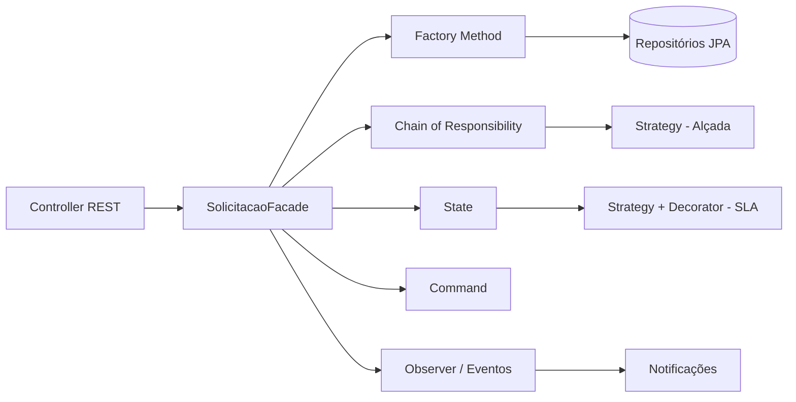
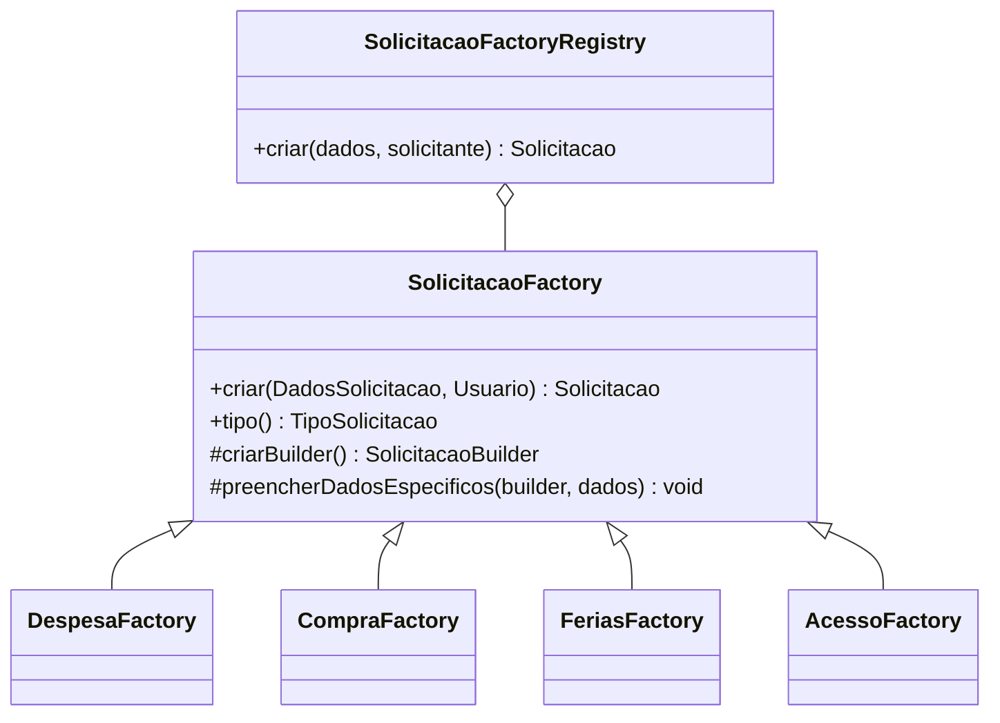
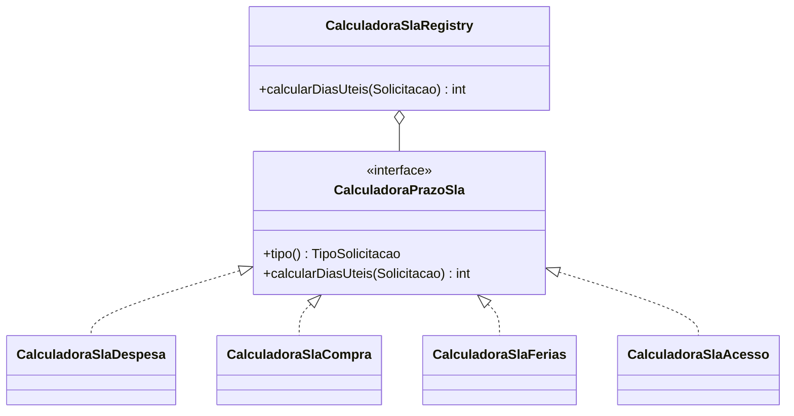
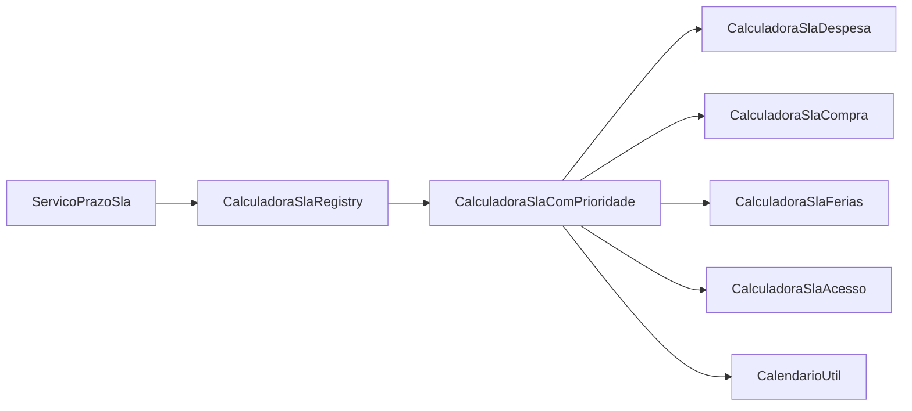
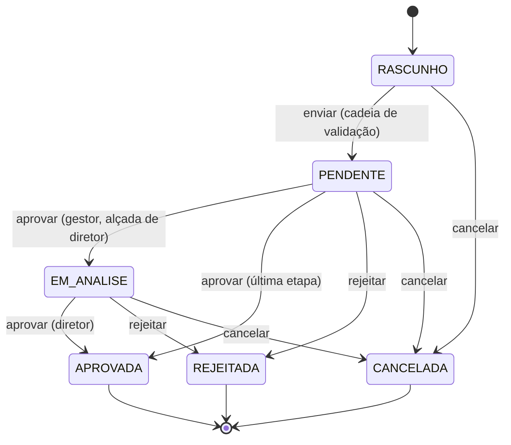
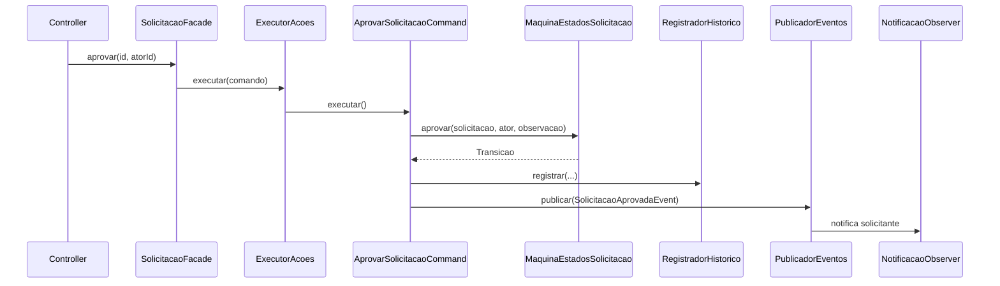
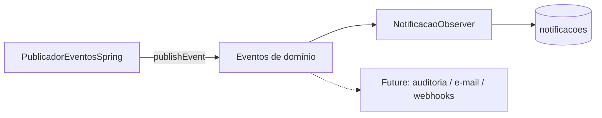
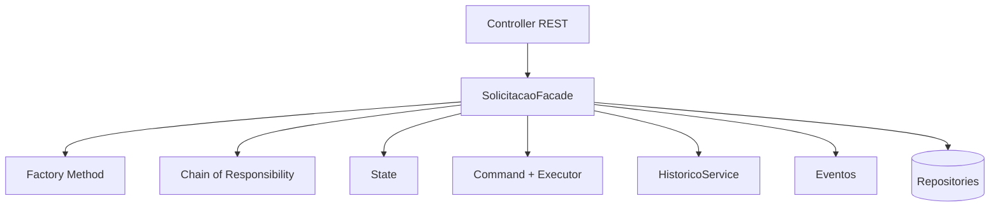

# Design Patterns aplicados no FlowPatterns

Este documento apresenta, de forma didática, cada padrão de projeto (GoF) aplicado
na plataforma, indicando **categoria**, **problema resolvido**, **classes envolvidas**,
**localização no código**, **funcionamento** e **benefícios**.

---

## Visão geral

| Padrão | Categoria | Onde vive | Problema resolvido |
|---|---|---|---|
| Factory Method | Criacional | `domain/solicitacao/factory` | Criar o subtipo correto de solicitação conforme o tipo informado |
| Builder | Criacional | `domain/solicitacao` | Construir objetos com muitos campos sem construtores telescópicos |
| Singleton | Criacional | Framework (Spring) | Garantir uma única instância de serviços e repositórios |
| Strategy | Comportamental | `domain/solicitacao/strategy` | Variar a política de SLA e de alçada por tipo/regra |
| Chain of Responsibility | Comportamental | `domain/solicitacao/chain` | Aplicar validações sequenciais e roteamento no envio |
| State | Comportamental | `domain/solicitacao/state` | Controlar transições do ciclo de vida da solicitação |
| Command | Comportamental | `domain/solicitacao/command` | Encapsular decisões (aprovar/rejeitar/cancelar) como objetos executáveis |
| Observer | Comportamental | `domain/event` + `service/NotificacaoObserver` | Notificar participantes sem acoplar o fluxo ao canal de comunicação |
| Facade | Estrutural | `service/SolicitacaoFacade` | Simplificar a orquestração do fluxo de solicitações |
| Decorator | Estrutural | `domain/solicitacao/strategy` | Aplicar ajustes sobre um cálculo de SLA existente |
| Proxy / Repository | Estrutural (framework) | Spring Data JPA | Persistência desacoplada e *lazy loading* |



---

## 1. Factory Method (Criacional)

**Problema resolvido.** Uma solicitação pode assumir quatro formatos (despesa, compra,
férias e acesso). Cada formato possui campos próprios e regras de validação distintas.
Sem um mecanismo de criação, o serviço conheceria todos os subtipos e o `switch` de
criação cresceria a cada novo tipo.

**Classes envolvidas.**

| Classe | Papel |
|---|---|
| `SolicitacaoFactory` | Creator abstrato: define o algoritmo comum de criação |
| `DespesaFactory`, `CompraFactory`, `FeriasFactory`, `AcessoFactory` | Creators concretos |
| `SolicitacaoFactoryRegistry` | Seleciona o creator concreto conforme o tipo |

**Localização.** `src/main/java/com/rafaelkamp/flowpatterns/domain/solicitacao/factory/`

**Funcionamento.** O creator abstrato executa o algoritmo comum (montar o builder,
aplicar dados comuns, construir e validar), delegando a cada creator concreto apenas
a escolha do builder e o preenchimento dos campos específicos.



**Benefícios.** O `if/switch` desaparece do serviço; adicionar um novo tipo de
solicitação exige apenas uma nova entidade, um builder e uma nova factory — sem
alterar o código existente. Testes isolados em `SolicitacaoFactoryTest`.

---

## 2. Builder (Criacional)

**Problema resolvido.** `Solicitacao` possui 13 campos em comum, somados aos campos
específicos de cada subtipo. Construtores com todos os parâmetros seriam ilegíveis e
frágeis (construtores telescópicos).

**Classes envolvidas.** `SolicitacaoBuilder` (base abstrata) e os builders aninhados
`SolicitacaoDespesa.Builder`, `SolicitacaoCompra.Builder`, `SolicitacaoFerias.Builder`
e `SolicitacaoAcesso.Builder`.

**Localização.** `src/main/java/com/rafaelkamp/flowpatterns/domain/solicitacao/`

**Funcionamento.** O builder recebe os dados de forma fluente, passo a passo, e
materializa a entidade somente no `build()`. A validação de domínio
(`validarDadosEspecificos()`) é executada pela factory após a construção.

```java
SolicitacaoDespesa despesa = new SolicitacaoDespesa.Builder()
        .valor(new BigDecimal("1250.00"))
        .categoriaDespesa(CategoriaDespesa.VIAGEM)
        .centroCusto("CC-10")
        .dadosComuns("Viagem", "Viagem de trabalho", Prioridade.ALTA, solicitante)
        .build();
```

**Benefícios.** Código de criação legível, imutabilidade durante a montagem e
eliminação de parâmetros ambíguos.

---

## 3. Singleton (Criacional) — suportado pelo Spring

**Problema resolvido.** Serviços, repositórios e estratégias de cálculo não devem ser
recriados a cada requisição; precisam manter estado consistente e ser compartilhados.

**Implementação.** Todo bean gerenciado pelo Spring é, por padrão, um singleton
(escopo `Singleton`). A documentação de cada classe deixa isso explícito, por exemplo:

```java
/**
 * Implementação da <b>Strategy</b> ... como essa classe é um {@link Service},
 * ela será tratada como um <b>Singleton</b>.
 */
@Service
public class UsuarioService { ... }
```

**Localização.** `service/`, `repository/`, `domain/**` (componentes `@Component`).

**Benefícios.** Reaproveitamento de instâncias, injeção de dependências segura e
baixo custo de inicialização. O estado mutável é evitado por completo: o `Clock` e o
`ZoneId` são imutáveis e injetados.

> Observação: nos laboratórios de referência o Singleton foi implementado manualmente
> (`SingletonEager`, `SingletonLazy`, `SingletonLazyHolder`). No projeto final, o
> contêiner do Spring assume esse papel — a mesma intenção de projeto, sem reinventar
> o gerenciamento de ciclo de vida.

---

## 4. Strategy (Comportamental)

**Problema resolvido.** O prazo de SLA e a alçada de aprovação dependem do tipo e do
valor da solicitação. Codificar essas regras com `if/else` misturaria política de
negócio com fluxo de aplicação.

### 4.1 Estratégias de SLA

| Classe | Prazo base (dias úteis) |
|---|---|
| `CalculadoraSlaDespesa` | 3 |
| `CalculadoraSlaCompra` | 5 |
| `CalculadoraSlaFerias` | 7 |
| `CalculadoraSlaAcesso` | 2 |

### 4.2 Estratégias de alçada

| Classe | Regra |
|---|---|
| `PoliticaAlcadaDespesa` | acima de R$ 5.000,00 → `DIRETOR`; abaixo → `GESTOR` |
| `PoliticaAlcadaCompra` | acima de R$ 20.000,00 → `DIRETOR`; abaixo → `GESTOR` |
| `PoliticaAlcadaFerias` | mais de 20 dias → `DIRETOR`; abaixo → `GESTOR` |
| `PoliticaAlcadaAcesso` | nível `ADMINISTRATIVO` → `DIRETOR`; demais → `GESTOR` |

**Localização.** `domain/solicitacao/strategy/` e `domain/solicitacao/strategy/alcada/`

**Funcionamento.** Cada estratégia implementa uma interface comum. Registros
(`CalculadoraSlaRegistry` e `PoliticaAlcadaRegistry`) recebem todas as implementações
via injeção do Spring e indexam-nas por `TipoSolicitacao`. O limiar monetário é
externalizado em `AlcadasProperties` (`flowpatterns.alcadas.*`), permitindo ajuste
por ambiente sem recompilar.



**Benefícios.** Regras isoladas, testáveis e extensíveis; eliminação de condicionais
no serviço; configuração por ambiente.

---

## 5. Decorator (Estrutural)

**Problema resolvido.** O ajuste por prioridade (URGENTE reduz o prazo) precisa ser
aplicado a **todas** as estratégias de SLA sem duplicar a regra nem alterar as
implementações existentes.

**Classe envolvida.** `CalculadoraSlaComPrioridade`, que implementa a mesma interface
`CalculadoraPrazoSla` e delega ao componente interno (o *decorated*).

**Localização.** `domain/solicitacao/strategy/CalculadoraSlaComPrioridade.java`

**Funcionamento.** O `CalculadoraSlaRegistry` compõe cada estratégia concreta com o
decorator no momento do registro. O prazo final é convertido em data pelo
`ServicoPrazoSla`, que usa o `CalendarioUtil` para contar apenas dias úteis
(fim de semana e feriados nacionais são ignorados).



**Benefícios.** Composição em tempo de execução, sem alterar o comportamento base e
combinação livre de políticas (prioridade + dias úteis + feriados).

---

## 6. Chain of Responsibility (Comportamental)

**Problema resolvido.** O envio de uma solicitação exige várias verificações
independentes (status, dados, duplicidade, alçada, disponibilidade de aprovador).
Encadear `if`s no serviço tornaria o método longo e acoplado.

**Classes envolvidas.**

| Handler | Responsabilidade |
|---|---|
| `ValidadorStatusRascunho` | Garante que só rascunhos de solicitantes ativos sejam enviados |
| `ValidadorDadosObrigatorios` | Valida campos comuns e específicos |
| `ValidadorDuplicidade` | Impede títulos repetidos em andamento para o mesmo solicitante |
| `ValidadorAlcada` | Define o nível final de aprovação (Strategy de alçada) |
| `ValidadorAprovador` | Seleciona o aprovador disponível para o nível inicial |

**Localização.** `domain/solicitacao/chain/` e `config/CadeiaValidacaoConfig.java`

**Funcionamento.** Cada handler conhece apenas o próximo. Se uma validação falha, a
exceção interrompe a cadeia e nenhum handler posterior é executado. O contexto
(`ContextoEnvio`) é carregado adiante com os resultados do roteamento (nível final,
nível inicial e aprovador).

```mermaid
flowchart LR
    ENV[POST /solicitacoes/{id}/envio] --> H1{Status = RASCUNHO?}
    H1 -- não --> X1[422 Transição inválida]
    H1 -- sim --> H2{Dados obrigatórios?}
    H2 -- não --> X2[422 Regra de negócio]
    H2 -- sim --> H3{Duplicidade?}
    H3 -- sim --> X3[409 Conflito]
    H3 -- não --> H4[Alçada definida]
    H4 --> H5{Aprovador disponível?}
    H5 -- não --> X4[422 Aprovador indisponível]
    H5 -- sim --> OK[Solicitação enviada]
```

**Benefícios.** Cada regra vira uma classe testável isoladamente; novas validações
entram na cadeia sem alterar os handlers existentes; a ordem de execução fica
explícita no único ponto de montagem (`CadeiaValidacaoConfig`).

---

## 7. State (Comportamental)

**Problema resolvido.** Uma solicitação percorre estados (RASCUNHO → PENDENTE →
EM_ANALISE → APROVADA/REJEITADA/CANCELADA). Cada estado permite um conjunto diferente
de transições. Com `switch` sobre o status, as regras ficariam espalhadas por
serviços e comandos.

**Classes envolvidas.** `EstadoSolicitacao` (interface), `EstadoRascunho`,
`EstadoPendente`, `EstadoEmAnalise`, `EstadoAprovada`, `EstadoRejeitada`,
`EstadoCancelada`, além das bases `EstadoSolicitacaoBase`, `EstadoAguardandoAprovacao`
e `EstadoFinal`. `MaquinaEstadosSolicitacao` funciona como o *contexto* do padrão.

**Localização.** `domain/solicitacao/state/`

**Funcionamento.** A máquina localiza o estado atual da solicitação e delega a
transição. O estado `EstadoAguardandoAprovacao` implementa a lógica compartilhada das
duas etapas de aprovação: quando o nível atual é `GESTOR` e o final é `DIRETOR`, a
aprovação avança a solicitação para `EM_ANALISE` e seleciona o próximo aprovador.



**Benefícios.** Regras de transição centralizadas e verificáveis; estados finais
garantem imutabilidade; a máquina permite testes unitários sem container.

---

## 8. Command (Comportamental)

**Problema resolvido.** "Aprovar", "rejeitar" e "cancelar" compartilham a mesma
estrutura (destinatário, ator, observação, auditoria e evento), precisam ser
executadas tanto individualmente quanto em lote e devem registrar histórico.

**Classes envolvidas.** `AcaoSolicitacao` (interface), `AprovarSolicitacaoCommand`,
`RejeitarSolicitacaoCommand`, `CancelarSolicitacaoCommand`, a factory de comandos
`AcaoFactory` e o *invoker* `ExecutorAcoes`.

**Localização.** `domain/solicitacao/command/`

**Funcionamento.** Cada comando encapsula a intenção, executa a transição via máquina
de estados, registra o histórico e publica o evento de domínio correspondente. O
invoker executa comandos sem conhecer o tipo concreto, o que habilita a ação em lote
(`ExecutorLoteService`), em que cada item roda em uma transação independente.



**Benefícios.** Ações reutilizáveis e auditáveis; inclusão de rotas em lote com
isolamento de falhas (o resultado é informado item a item); histórico completo.

---

## 9. Observer (Comportamental)

**Problema resolvido.** A aprovação de uma solicitação precisa avisar os envolvidos
(notificação interna, auditoria, integrações futuras) sem que o fluxo de aprovação
conheça esses canais.

**Classes envolvidas.** `EventosSolicitacao` (records de evento), `PublicadorEventos`
(porta) e `PublicadorEventosSpring` (adaptador para o `ApplicationEventPublisher` do
Spring) e o ouvinte `NotificacaoObserver`.

**Localização.** `domain/event/` e `service/NotificacaoObserver.java`

**Funcionamento.** O fluxo publica eventos de domínio; o Spring aplica o padrão
*Observer* para entregá-los aos ouvintes. O `NotificacaoObserver` transforma cada
evento em uma notificação persistida para o usuário correspondente.

| Evento | Notificações geradas |
|---|---|
| `SolicitacaoCriadaEvent` | Solicitante (confirmação de criação) |
| `SolicitacaoEnviadaEvent` | Aprovador atual (nova solicitação para aprovar) |
| `SolicitacaoAprovadaEvent` | Solicitante e, na primeira etapa, próximo aprovador |
| `SolicitacaoRejeitadaEvent` | Solicitante (com o motivo) |
| `SolicitacaoCanceladaEvent` | Solicitante (com o motivo) |



**Benefícios.** Baixo acoplamento, extensão por novos ouvintes sem alterar o
domínio, canal de comunicação independente do fluxo de aprovação.

---

## 10. Facade (Estrutural)

**Problema resolvido.** O controller conheceria fábrica, cadeia de validação, máquina
de estados, comandos, histórico, eventos e SLA para atender uma única requisição.

**Classe envolvida.** `SolicitacaoFacade` (com `UsuarioService`, `HistoricoService`,
`NotificacaoService` e `PainelService` como colaboradores).

**Localização.** `service/SolicitacaoFacade.java`

**Funcionamento.** A facade expõe operações de alto nível (`criar`, `atualizar`,
`enviar`, `aprovar`, `rejeitar`, `cancelar`, `executarLote`, `buscarPorId`, `listar`,
`historico`, `excluirRascunho`) e orquestra os participantes internos. O controller
fala apenas com a facade.



**Benefícios.** Interface única e estável para a API; regras de orquestração em um
único lugar; controllers enxutos e testáveis.

---

## 11. Proxy e Repository (Estrutural — apoio do framework)

**Problema resolvido.** Acesso a dados com Criteria API e JPQL diretamente nos serviços
geraria
forte acoplamento à tecnologia de persistência.

**Implementação.** `SolicitacaoRepository`, `UsuarioRepository`,
`HistoricoSolicitacaoRepository` e `NotificacaoRepository` estendem
`JpaRepository`/`JpaSpecificationExecutor`. O Spring Data gera, em tempo de execução,
um *proxy* que implementa a interface do repositório e aplica *lazy loading* nas
relações (`solicitante`, `aprovadorAtual`).

**Benefícios.** Persistência trocável (H2 em desenvolvimento, PostgreSQL em produção),
consultas dinâmicas com `Specification` (filtros e paginação) e nenhum SQL no código
de negócio.

---

## 12. Onde cada padrão é verificado por testes

| Padrão | Teste |
|---|---|
| Factory Method / Builder | `SolicitacaoFactoryTest` |
| Strategy / Decorator | `CalculadoraSlaTest` |
| Chain of Responsibility | `CadeiaValidacaoEnvioTest` |
| State | `MaquinaEstadosSolicitacaoTest` |
| Command | `ComandoSolicitacaoTest` |
| Observer | `NotificacaoObserverTest` |
| Facade (fluxo completo) | `FluxoSolicitacaoIntegrationTest` |
| Controllers e tratamento de erros | `SolicitacaoControllerTest`, `UsuarioControllerTest` |
| Regras de usuário | `UsuarioServiceTest` |
